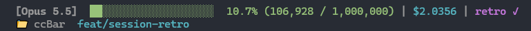

# ccBar

A two-line ANSI status bar for [Claude Code](https://claude.ai/code), showing context window usage, model name, cost (optional), and live git status.

**Zero token cost.** ccBar runs entirely as a local subprocess. Claude never sees its input or output, so it adds no API cost and no context usage.

---

## What it shows

**Line 1** — Model name (bold) + color-coded context bar + percentage and token counts + optional cost estimate (yellow from $10, red from $30) + session duration (e.g. `1h4m`) + `retro ✓` once the session retro has fired + `handoff ✓` once the session handoff has fired.

**Line 2** — Folder name + git branch + a dirty marker (`*`) when anything is uncommitted, untracked files included + `+N/-N` line counts covering both staged and unstaged changes + plan rate limits + the prompt cache group (e.g. `cache 92% warm 3m`).

Bar colors: green ≤ 60%, yellow ≤ 80%, red > 80% (thresholds configurable).

---

## Requirements

- Python 3.8+ (standard library only, no pip packages)
- Claude Code CLI

---

## Install

```sh
cd ccBar
python install.py
```

The installer is safe to re-run after any update — just `git pull` and run it again.

What it does each time:

1. Detects the correct Python invocation (prefers the Windows `py` launcher so a missing `python` on PATH never silently breaks the bar).
2. Always copies the latest `ccbar.py` to `~/.claude/ccbar.py` (picks up script changes), unless installed in place (see below).
3. Copies every skill under `skills/` into `~/.claude/skills/`.
4. Copies `config.example.json` to `~/.claude/ccbar.config.json` on first install only — your config is preserved on re-runs so customizations are never lost.
5. Always updates the `statusLine` key in `~/.claude/settings.json`, preserving all other keys and backing the file up to `settings.json.bak` first (picks up command or format changes). It sets `refreshInterval` to 30 seconds so the rate limit reset countdowns tick between events.
6. Runs a self-test to confirm the renderer works.

Restart Claude Code after installing or updating.

### In-place install

If your machine blocks scripts under `~/.claude`, use `--in-place`:

```sh
python install.py --in-place
```

The status line and Stop hook then run `ccbar.py` straight from the clone, so keep the clone where it is. Config and state still live in `~/.claude`. The mode is sticky: a later plain `python install.py` stays in place. Pass `--copy` to switch back. If an old `~/.claude/ccbar.py` is left over, the installer offers to remove it.

### Updating

```sh
git pull
python install.py
```

### Options

| Flag | Effect |
|------|--------|
| `--in-place` | Run `ccbar.py` from the clone instead of copying it to `~/.claude` |
| `--copy` | Copy `ccbar.py` to `~/.claude` (the default; switches back from `--in-place`) |
| `--dry-run` | Print what would change; write nothing |
| `--no-verify` | Skip self-test |
| `--reset-config` | Overwrite your config with the latest example (backs up existing first) |
| `--guards` | Register the [guard hooks](#guards) |
| `--no-guards` | Remove the guard hooks |
| `--uninstall` | Remove `statusLine`, the Stop hook, and guard hooks from settings, optionally restore backup and remove files |

---

## Uninstall

```sh
python install.py --uninstall
```

Guard hooks are removed along with the status line and Stop hook.

---

## Configuration

Copy `config.example.json` to `~/.claude/ccbar.config.json` (the installer does this automatically). All keys are optional; missing keys fall back to built-in defaults.

### Segments

```json
"segments": {
  "model": true,
  "context_bar": true,
  "context_pct": true,
  "cost": false,
  "duration": true,
  "git_branch": true,
  "git_dirty": true,
  "git_changes": true,
  "retro": true,
  "handoff": true,
  "effort": true,
  "worktree": true,
  "rate_limits": true,
  "prompt_cache": true
}
```

### Bar appearance

```json
"bar": {
  "width": 20,
  "filled_char": "█",
  "empty_char": "░",
  "thresholds": { "green": 60, "yellow": 80 }
}
```

Switch to ASCII: set `"filled_char": "#"` and `"empty_char": "-"`.

### Colors

Valid values: `reset`, `bold`, `black`, `red`, `green`, `yellow`, `blue`, `magenta`, `cyan`, `white`, `gray`.

`bar_empty` colors the unfilled cells; `null` (the default) uses the fill color; `gray` is a good dim choice.

```json
"colors": {
  "model": "bold",
  "bar_green": "green",
  "bar_yellow": "yellow",
  "bar_red": "red",
  "bar_empty": null,
  "cost": "cyan",
  "duration": "white",
  "branch": "cyan",
  "dirty": "yellow",
  "insertions": "green",
  "deletions": "red",
  "retro": "magenta",
  "handoff": "blue",
  "worktree": "cyan",
  "cache_warm": "green",
  "cache_cold": "yellow"
}
```

Set `"no_color": true` to strip all ANSI codes.

### Cost

```json
"cost": {
  "show": false,
  "decimals": 4,
  "thresholds": { "yellow": 10.0, "red": 30.0 }
}
```

The cost figure is an **estimate** taken from Claude Code's own tracking. It is not your billed charge.

`thresholds` are in USD. Below `yellow` the cost uses `colors.cost`; from `yellow` it uses `colors.bar_yellow`, and from `red` `colors.bar_red`.

### Git

```json
"git": {
  "dirty_marker": "*",
  "timeout_ms": 800,
  "cache_ttl_ms": 3000
}
```

- `timeout_ms`: cap on each git call, in milliseconds. A call that runs longer is dropped and its part of line 2 (branch or line counts) is left out.
- `cache_ttl_ms`: how long a git result is reused, in milliseconds. ccBar caches branch, line counts and dirty state per session in `~/.claude/ccbar-state/<session>.json` and re-runs git once the TTL passes or the working directory changes. A cache hit runs no git. A commit, checkout or reset clears the marker right away (ccBar watches the timestamp of the repo's HEAD reflog); discarding changes without a commit can leave it up until the TTL passes.
- `dirty_marker`: text drawn right after the branch (in `colors.dirty`) when `git status --porcelain` reports anything, untracked files included. Toggle with `segments.git_dirty`.

### Icons / glyphs

```json
"icons": {
  "branch": "🌿",
  "folder": "📁",
  "dirty": null,
  "worktree": "⎇",
  "ascii_fallback": false
}
```

Set `"ascii_fallback": true` to suppress any glyph icons and use plain labels only.

`dirty`: glyph used instead of `git.dirty_marker` when set; ignored under `ascii_fallback`.

`worktree`: glyph before the worktree name on line 2; an empty string or `ascii_fallback` shows `wt ` instead.

### Rate limits

```json
"rate_limits": {
  "show_reset": true
}
```

Line 2 shows plan usage for the 5-hour and 7-day windows, colored by `bar.thresholds`, e.g. `5h 23% (2h10m)  7d 41%`. `show_reset` adds the time left until each window resets. Claude Code only sends rate limits for Pro/Max plans, after the first response in a session. Toggle with `segments.rate_limits`.

### Prompt cache

After the rate limits, line 2 shows the prompt cache, e.g. `cache 92% warm 3m` or `cache 92% cold`: the cache hit ratio, whether the cached prefix is still warm (`colors.cache_warm`) or has gone cold (`colors.cache_cold`), and the time left before a warm cache expires. It appears after the first response, needs Claude Code v2.1.251+, and counts only the main conversation, not subagents. Nothing shows when caching isn't observed. Toggle with `segments.prompt_cache`.

---

## Session retro

Once per session, when context reaches `threshold_tokens` or `threshold_pct` of the model window (whichever comes first), the next response end triggers the `session-retro` skill. Claude reviews the session for what went wrong, what could have been done better, and what to improve next time.

**How.** The status line writes `~/.claude/ccbar-state/<session_id>.json` at the crossing. The Stop hook (`ccbar.py --stop-hook`, registered by the installer) reads it and injects the instruction once. State is per session, so concurrent sessions don't interfere. State files older than 7 days are pruned.

**Output.** A retro file in `~/.claude/retros/*.md`, plus numbered memory/CLAUDE.md proposals that are only applied on your approval. Lessons target the nearest existing CLAUDE.md; the retro never proposes creating a new one inside a git repo.

**Manual run.** `/session-retro` at any time.

Once the retro has fired, line 1 of the bar shows a `retro ✓` marker:



```json
"retro": {
  "enabled": true,
  "threshold_tokens": 400000,
  "threshold_pct": 70
}
```

---

## Session handoff

Once per session, when context reaches the handoff's `threshold_tokens` or `threshold_pct` (whichever comes first), the next response end triggers the `session-handoff` skill. Claude writes a self-contained plan so a fresh session can pick up the work. If the retro and the handoff cross together, the retro fires first and the handoff at the next response end.

**How.** Same mechanism as the retro: the status line records the crossing in the session's state file and the Stop hook injects the instruction once.

**Output.** A plan in `plans_dir` named after the work, plus one line in chat built from `prompt_template` with `{path}` replaced by the plan's absolute path, ready to paste into a new session.

**Manual run.** `/session-handoff` at any time.

Once the handoff has fired, line 1 of the bar shows a `handoff ✓` marker.

```json
"handoff": {
  "enabled": true,
  "threshold_tokens": 600000,
  "threshold_pct": 85,
  "plans_dir": "~/.claude/plans",
  "prompt_template": "Read and execute this plan at: {path}"
}
```

---

## Guards

Opt-in hooks that catch mistakes Claude makes while editing. Off until you register them:

```sh
python install.py --guards
```

`--no-guards` removes them. A plain `python install.py` keeps whatever is registered and refreshes the commands. Guards always run `guards.py` straight from the clone, in both install modes, so keep the clone where it is.

**Line endings.** After every Edit or Write, `guards.py --line-endings` compares the file with `git cat-file --filters HEAD:<path>`, which applies `core.autocrlf` and `.gitattributes` exactly as a checkout would. If the file now has LF lines where the checkout form is CRLF (or the reverse), the hook exits 2 and Claude is told to convert them back. Files outside a repo, untracked files, and files with no clear style in git are skipped.

**Posted text.** Before every Bash or PowerShell command (the hook matcher is `Bash|PowerShell`, since Claude on Windows posts through either tool), `guards.py --posted-text` checks commands that post text other people read: `gh pr` and `gh issue` `create`, `edit`, `comment`, and `review`; `gh api` calls to a `reviews` or `comments` endpoint; `az repos pr create|update`; `az boards work-item create|update`; and `az devops invoke` when `--resource` names threads or comments. If the command, or a body file it references (`--body-file`, `-F`, `--input`, `--in-file`, `key=@file`, `@file`), contains an entry from `banned`, the hook exits 2 and Claude is told to rewrite the text. Entries are literal substrings, not patterns. The default bans the em dash (U+2014). A `banned` list in your config replaces the default rather than adding to it, so include the em dash if you still want it. Every other command costs one regex search.

**Build gate.** Before every `git push` (including `git -C <dir> push`) or `gh pr create`, `guards.py --build-gate` builds the code the push is about to send. The repo is the payload's `cwd`, or the `<dir>` of a leading `cd <dir> &&` or of `git -C <dir>`. It lists the files changed by unpushed commits, compared with the branch's upstream, or `origin/HEAD` when there is none, and maps each one through the `builds` table. A row is `{"glob": ..., "root_marker": ..., "command": [...]}`. A file matching `glob` walks up from its directory to the repo root, and the first directory holding an entry that matches `root_marker` is its project root. Both are `fnmatch` patterns matched against repo-relative paths, where `*` crosses `/`, so `*.cs` matches `src/a/b.cs`. `command` is an argument list, not a shell string, and runs in the root. Each root builds once per push, with a timeout of 840 seconds. The build runs against the working tree. If a build fails, the hook exits 2 with the last 40 lines of its output and Claude is told to fix the errors before pushing. A build tool that isn't on PATH, a timeout, or a git failure lets the push through with one warning line. The table is empty by default, which turns the gate off. Every other command costs one regex search.

Switch a guard off, or change the banned list, without reinstalling:

```json
"guards": {
  "line_endings": {
    "enabled": true
  },
  "posted_text": {
    "enabled": true,
    "banned": ["—"]
  },
  "build_gate": {
    "enabled": true,
    "builds": []
  }
}
```

A .NET example that builds the nearest solution when C# files change. Plain `dotnet build` restores packages as needed:

```json
"build_gate": {
  "enabled": true,
  "builds": [
    {"glob": "*.cs", "root_marker": "*.sln", "command": ["dotnet", "build", "-v", "q", "-clp:ErrorsOnly"]}
  ]
}
```

---

## Self-test

```sh
python ccbar.py --selftest
# or after install:
python ~/.claude/ccbar.py --selftest
```

Feeds two mock payloads (200k and 1M context windows) through the renderer and prints the result.

Unit tests:

```sh
py -3 -m unittest discover -s tests
```

---

## Troubleshooting

**Blank status line with no error.** The most common cause is `python` not being on PATH. The installer works around this by recording the absolute interpreter path in `settings.json`. If you installed manually, check that the `statusLine` command in `~/.claude/settings.json` points to a real Python binary.

**Status line shows raw text / garbled characters.** Your terminal may not support UTF-8 block characters. Set `"filled_char": "#"`, `"empty_char": "-"`, and `"ascii_fallback": true` in the config.

**Git info missing.** Verify `git` is on PATH in the shell Claude Code inherits. On macOS the Xcode Command Line Tools may need to be installed (`xcode-select --install`).

**Status line is slow.** Each git call is capped by `git.timeout_ms` (default 800). Lower it if git is slow in a large repo; a call that times out is left off the bar instead of holding it up. Git results are cached for `git.cache_ttl_ms` (default 3000); raise it to run git less often.

---

## License

MIT. See LICENSE.
