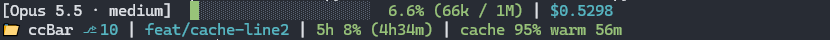
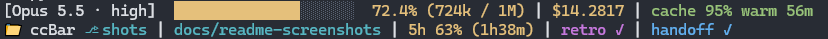

# ccBar

A two-line status line for [Claude Code](https://claude.ai/code): model, context usage, cost, git state, plan usage and prompt cache at a glance. It also ships optional session hooks that run a retro and write a handoff plan as a long session fills its context, and optional guard hooks that catch line-ending, posted-text and build mistakes before they land.



Later in a long session, context and cost turn yellow and the retro and handoff markers appear once they fire:



Every segment, with all the optional markers showing:

```
[Claude Opus 4.8 · high]  ████████░░░░░░░░░░░░  41.2% (412k / 1M) | $1.2345 | cache 92% warm 3m | retro ✓
📁 ccBar ⎇ feat-x | 🌿 main*  +12/-3 | 5h 23% (2h10m)
```

**Zero token cost.** ccBar runs as a local subprocess. Claude never sees its input or output, so the status line adds no API cost and no context usage.

---

## Requirements

- Python 3.8+ (standard library only, no pip packages)
- git, for the git segments
- Claude Code. The prompt cache group needs v2.1.251 or later; older versions simply don't show it.

---

## Install

```sh
git clone https://github.com/Valehead/ccBar.git
cd ccBar
python install.py
```

On Windows, `py -3 install.py` works too. Restart Claude Code afterwards.

The installer:

1. Finds a working Python 3 (preferring the Windows `py` launcher) and writes its command into the status line, so a missing `python` on PATH doesn't break the bar.
2. Points the status line at `ccbar.py` in the clone, so keep the clone where it is.
3. Copies the `session-retro` and `session-handoff` skills into `~/.claude/skills/`.
4. Copies `config.example.json` to `~/.claude/ccbar.config.json` if you don't have a config yet. An existing config is left alone.
5. Backs up `~/.claude/settings.json` to `settings.json.bak`, then sets `statusLine` and registers ccBar's Stop hook, keeping every other key. `statusLine.refreshInterval` is set to 30 seconds, so the bar redraws while Claude is idle and countdowns keep ticking.
6. Runs the self-test.
7. Prints the config path and, if guard hooks aren't registered, the command to add them.

### Installing direct

To copy `ccbar.py` into `~/.claude` instead of running it from the clone:

```sh
python install.py --install-direct
```

The clone can then move or be deleted, but a `git pull` only reaches the bar after you re-run the installer. Config, state and skills live in `~/.claude` in both modes. Re-running the installer keeps whichever mode is installed; pass `--install-inside-repo` to switch back. If a copied `~/.claude/ccbar.py` is left over after switching back, the installer offers to remove it.

### Installer options

| Flag | Effect |
|------|--------|
| `--install-inside-repo` | Run `ccbar.py` from the clone (the default mode) |
| `--install-direct` | Copy `ccbar.py` to `~/.claude` instead of running it from the clone |
| `--guards` | Register the [guard hooks](#optional-guard-hooks) |
| `--dotnet` | Add the `dotnet` [build gate](#build-gate) preset to your config and register the guard hooks (implies `--guards`) |
| `--no-guards` | Remove the guard hooks |
| `--reset-config` | Replace your config with `config.example.json`, backing yours up to `ccbar.config.json.bak` first |
| `--dry-run` | Print what would change; write nothing |
| `--no-verify` | Skip the self-test |
| `--uninstall` | Remove ccBar from `settings.json` and offer to remove its files (see [Uninstall](#uninstall)) |

---

## What you get by default

### The status line

Segments with nothing to show are left out.

**Line 1**

| Segment | Example | Switch off with |
|---------|---------|-----------------|
| Model | `[Claude Opus 4.8]` | `segments.model` |
| Effort level, inside the model bracket when Claude Code reports one | `· high` | `segments.effort` |
| Fast mode, inside the model bracket when `/fast` is on | `· fast` | `segments.fast` |
| Context bar: green up to 60%, yellow up to 80%, red above | `████████░░░░` | `segments.context_bar` |
| Context used, as a percentage and in tokens | `41.2% (412k / 1M)` | `segments.context_pct` |
| Session cost, an estimate from Claude Code, not your bill. Turns yellow from $10, red from $30 | `$1.2345` | `segments.cost` |
| Prompt cache: hit ratio, warm (green, with time left before it expires) or cold (yellow). Appears after the first response and counts only the main conversation, not subagents | `cache 92% warm 3m` | `segments.prompt_cache` |
| Retro marker, once the session retro has fired | `retro ✓` | `segments.retro` |
| Handoff marker, once the session handoff has fired | `handoff ✓` | `segments.handoff` |

**Line 2**

| Segment | Example | Switch off with |
|---------|---------|-----------------|
| Folder, or the main repo's name inside a git worktree | `📁 ccBar` | always shown (`icons.folder: ""` drops the icon) |
| Worktree marker and short name, right after the repo name. A leading `<repo>-` is dropped from the worktree name | `📁 ccBar ⎇ feat-x` | `segments.worktree` |
| Git branch, cut to 30 characters | `🌿 main` | `segments.git_branch` |
| Dirty marker: anything uncommitted, untracked files included | `*` | `segments.git_dirty` |
| Lines added and removed in tracked files compared with the last commit, staged and unstaged together | `+12/-3` | `segments.git_changes` |
| Plan usage for the 5-hour window, with time until it resets. Colored by the context bar thresholds. Claude Code sends this only on Pro and Max plans, after the first response | `5h 23% (2h10m)` | `segments.rate_limits` |

Every switch is a boolean under `segments` in your [config](#configuration).

### Subagent rows

While subagents run, Claude Code lists them under the prompt. ccBar draws each row as the agent type, its current task, a 5-character context bar with percentage and tokens, and time since it started:

`Explore · Find install hooks  ██░░░ 41% (82k)  3m`

The bar uses the same characters, thresholds and colors as the status line. Without a known context window the row shows tokens only. The agent type needs Claude Code v2.1.293 or later. When the terminal is narrow, only the task text is cut. Switch off with `segments.subagents`; Claude Code then draws its default rows. If your `settings.json` already has a `subagentStatusLine` that isn't ccBar's, the installer leaves it alone.

### Session retro and handoff

Both are on by default. The status line watches context usage; the Stop hook the installer registers acts on it at the end of Claude's next response.

| | Session retro | Session handoff |
|---|---|---|
| Fires | Once per session, at 400,000 tokens or 70% of the model's context window, whichever comes first | Once per session, at 600,000 tokens or 85% of the window, whichever comes first |
| What Claude does | Runs the `session-retro` skill: reviews the session for what went wrong, what could have been done better, and what to improve next time | Runs the `session-handoff` skill: writes a self-contained plan so a fresh session can pick up the work |
| Writes | `~/.claude/retros/<date>-<folder>-<session>.md`, plus numbered memory or CLAUDE.md proposals that are applied only when you approve them | A plan in `~/.claude/plans/` named after the work, plus one line in chat to paste into a fresh session |
| Marker | `retro ✓` on line 1 | `handoff ✓` on line 1 |
| Run by hand | `/session-retro` | `/session-handoff` |
| Switch off | `"retro": {"enabled": false}` | `"handoff": {"enabled": false}` |

If both thresholds are crossed at once, the retro fires first and the handoff at the end of the following response. Retro lessons target auto-memory or an existing CLAUDE.md; the retro never proposes creating a CLAUDE.md inside a git repo.

**Session state.** Each session's state lives in `~/.claude/ccbar-state/<session_id>.json`: which events have crossed and fired, plus the git cache. Concurrent sessions don't interfere. Files older than 7 days are pruned. Any of them is safe to delete: deleting a session's file re-arms its retro and handoff, so they fire again on the next response while context is still over the threshold.

---

## Optional: guard hooks

Guards are hooks that catch mistakes Claude makes while editing and posting. They are off until you register them:

```sh
python install.py --guards
```

`python install.py --no-guards` removes them. A plain re-run keeps whatever is registered. Guards run `guards.py` from the clone in both install modes, so keep the clone where it is.

All three guards are registered together. Each one can be switched off on its own with `guards.<name>.enabled: false` (see [Guards config](#guards)), and two of them do nothing until you configure them.

### Line endings

**Use this if** you work in repos where git converts line endings (`core.autocrlf`, `.gitattributes`), which is common on Windows.
**Skip this if** your setup is LF everywhere.

After every Edit or Write, the guard checks that the file still has the line endings git checks it out with. If Claude wrote LF lines into a CRLF file (or the reverse), Claude is told to convert them back.

Details:
- Compares the file with `git cat-file --filters HEAD:<path>`, which applies `core.autocrlf` and `.gitattributes` exactly as a checkout would.
- Skips files outside a repo, untracked files, and files with no clear style in git.
- Blocks by exiting 2, which shows Claude the message.

### Posted text

**Use this if** there is text you never want in PR, issue or review text that Claude posts with `gh` or `az`.
**Skip this if** you don't have any such rule.

Does nothing until you fill `guards.posted_text.banned`. For example, to ban the em dash:

```json
"guards": {
  "posted_text": {
    "banned": ["—"]
  }
}
```

Before a posting command runs, the guard checks the command and any body file it references. On a hit, the command is blocked and Claude is told to rewrite the text.

Details:
- Entries are literal substrings, not patterns.
- Posting commands: `gh pr` and `gh issue` `create`, `edit`, `comment` and `review`; `gh api` calls to a `reviews` or `comments` endpoint; `az repos pr create|update`; `az boards work-item create|update`; `az devops invoke` when `--resource` names threads or comments; and any command that runs `az rest` and names a `threads` or `comments` URI anywhere, in any case (so a PowerShell `$uri` set before the call counts).
- Body files: `--body-file`, `-F`, `--input`, `--in-file`, `key=@file` and `@file`.
- Runs before every Bash and PowerShell command (Claude on Windows can post through either). Any other command costs one regex search.

### Build gate

**Use this if** you have a compiled or type-checked project and want a push blocked when the build is broken.
**Skip this if** your projects have no build step, or CI catching it is enough.

Does nothing until you add rows to `guards.build_gate.builds`. A row is:

```json
{"glob": "*.cs", "root_marker": ["*.sln", "*.slnx"], "command": ["dotnet", "build", "{marker}", "-v", "q", "-clp:ErrorsOnly"]}
```

A row can also be a preset name. `"dotnet"` stands for the .NET row above, so fixes to it reach you on `git pull`. `python install.py --dotnet` adds `"dotnet"` to your `builds` and registers the guard hooks in one step. To stop using it, remove `"dotnet"` from `builds`. An unknown name is skipped.

Before `git push` or `gh pr create`, the guard finds the files your unpushed commits change. Each file that matches a row's `glob` walks up from its directory to the repo root, and the first directory holding something that matches `root_marker` is its project root. The row's `command` runs there. If it fails, the push is blocked and Claude gets the last 40 lines of output and is told to fix the errors first.

Examples for several stacks. Keep only the rows for stacks you use:

```json
"guards": {
  "build_gate": {
    "builds": [
      {"glob": "*.cs", "root_marker": ["*.sln", "*.slnx"], "command": ["dotnet", "build", "{marker}", "-v", "q", "-clp:ErrorsOnly"]},
      {"glob": "*.ts", "root_marker": "package.json", "command": ["npm", "run", "build"]},
      {"glob": "*.rs", "root_marker": "Cargo.toml", "command": ["cargo", "build", "--quiet"]},
      {"glob": "*.go", "root_marker": "go.mod", "command": ["go", "build", "./..."]}
    ]
  }
}
```

The TypeScript row assumes your `package.json` has a `build` script. `dotnet build <file>` restores packages as needed.

Details:
- `glob` and `root_marker` are `fnmatch` patterns matched against repo-relative paths, where `*` crosses `/`, so `*.cs` matches `src/a/b.cs`.
- `root_marker` is one pattern or a list of patterns. The first directory holding anything that matches any of them is the root. Use `["*.sln", "*.slnx"]` rather than `"*.sln*"`, which also matches `.sln.DotSettings` files.
- `command` is an argument list, not a shell string.
- `{marker}` in `command` is replaced with each file in the root that matches `root_marker`, and the command runs once per file. Use it when a root can hold more than one solution, since a bare `dotnet build` refuses to pick one (MSB1011). When two matches share a base name, such as `MyApp.sln` and `MyApp.slnx`, only the one matched by the earlier pattern builds, so `["*.sln", "*.slnx"]` prefers the `.sln`. Rows without `{marker}` run once per root.
- Unpushed commits are compared with the branch's upstream, or `origin/HEAD` when there is none. The build itself runs against the working tree.
- The repo is the command's working directory, or the `<dir>` of a leading `cd <dir> &&` or of `git -C <dir> push`.
- Each project root builds once per push, or once per marker file with `{marker}`. Each build has a timeout of 840 seconds.
- Fails open: a build tool that isn't on PATH, a timeout, or a git failure lets the push through with one warning line.
- Any command that isn't a push costs one regex search.

---

## Configuration

ccBar reads `~/.claude/ccbar.config.json`. The installer creates it from `config.example.json` on first install.

- Every key is optional. A missing key uses its default, so you only need the keys you change.
- A list you set replaces the default list rather than adding to it.
- Unknown keys are ignored.

The blocks below show the defaults.

### Segments

```json
"segments": {
  "model": true,
  "context_bar": true,
  "context_pct": true,
  "cost": true,
  "git_branch": true,
  "git_dirty": true,
  "git_changes": true,
  "retro": true,
  "handoff": true,
  "effort": true,
  "fast": true,
  "worktree": true,
  "rate_limits": true,
  "prompt_cache": true,
  "subagents": true
}
```

See [The status line](#the-status-line) for what each one shows. `retro` and `handoff` hide only the markers; to stop the events, use `retro.enabled` and `handoff.enabled`.

### Bar

```json
"bar": {
  "width": 20,
  "filled_char": "█",
  "empty_char": "░",
  "thresholds": { "green": 60, "yellow": 80 }
}
```

- `thresholds`: context percentages. Green up to `green`, yellow up to `yellow`, red above. Rate limits use the same thresholds.
- For plain ASCII, set `"filled_char": "#"` and `"empty_char": "-"`.

### Colors

```json
"colors": {
  "model": "bold",
  "bar_green": "green",
  "bar_yellow": "yellow",
  "bar_red": "red",
  "bar_empty": null,
  "cost": "cyan",
  "branch": "cyan",
  "dirty": "yellow",
  "insertions": "green",
  "deletions": "red",
  "retro": "magenta",
  "handoff": "blue",
  "worktree": "cyan",
  "cache_warm": "green",
  "cache_cold": "yellow"
},
"no_color": false
```

- Valid values: `reset`, `bold`, `black`, `red`, `green`, `yellow`, `blue`, `magenta`, `cyan`, `white`, `gray`.
- `bar_green`, `bar_yellow`, `bar_red`: the context bar and percentage, and the rate limits.
- `bar_empty`: the unfilled bar cells. `null` uses the fill color; `gray` is a good dim choice.
- `cache_warm`, `cache_cold`: the prompt cache group.
- `no_color: true` strips all ANSI codes.

### Cost

```json
"cost": {
  "show": true,
  "decimals": 4,
  "thresholds": { "yellow": 10.0, "red": 30.0 }
}
```

- The figure is Claude Code's own estimate, not your billed charge.
- `show: false` hides it, the same as `segments.cost: false`.
- `thresholds` are in USD. Below `yellow` the cost uses `colors.cost`, from `yellow` it uses `colors.bar_yellow`, and from `red` `colors.bar_red`.

### Git

```json
"git": {
  "dirty_marker": "*",
  "timeout_ms": 800,
  "cache_ttl_ms": 3000
}
```

- `dirty_marker`: text drawn after the branch, in `colors.dirty`, when `git status --porcelain` reports anything, untracked files included.
- `timeout_ms`: cap on each git call. A slower call is dropped and its part of line 2 is left out instead of holding up the bar.
- `cache_ttl_ms`: how long a git result is reused. ccBar caches branch, line counts and dirty state in the session's state file and runs git again once the TTL passes or the working directory changes. A commit, checkout or reset clears the dirty marker right away (ccBar watches the repo's HEAD reflog); discarding changes without a commit can leave it up until the TTL passes.

### Icons

```json
"icons": {
  "branch": "🌿",
  "folder": "📁",
  "dirty": null,
  "worktree": "⎇",
  "ascii_fallback": false
}
```

- `branch`, `folder`: an empty string drops the icon.
- `dirty`: a glyph to use instead of `git.dirty_marker`. `null` uses `dirty_marker`.
- `worktree`: an empty string shows `wt ` instead.
- `ascii_fallback: true` drops every glyph: no icons, `-` as the effort separator, and `retro done` / `handoff done` as the markers.

### Rate limits

```json
"rate_limits": {
  "show_reset": true
}
```

- `show_reset`: show the time left until the 5-hour window resets.

### Retro

```json
"retro": {
  "enabled": true,
  "threshold_tokens": 400000,
  "threshold_pct": 70
}
```

- The retro fires at `threshold_tokens` or `threshold_pct` of the model's window, whichever comes first.

### Handoff

```json
"handoff": {
  "enabled": true,
  "threshold_tokens": 600000,
  "threshold_pct": 85,
  "plans_dir": "~/.claude/plans",
  "prompt_template": "Read and execute this plan at: {path}"
}
```

- `plans_dir`: where the handoff writes its plan.
- `prompt_template`: the line printed for you to paste into a fresh session. `{path}` becomes the plan's absolute path.

### Guards

These keys take effect only after `install.py --guards`.

```json
"guards": {
  "line_endings": {
    "enabled": true
  },
  "posted_text": {
    "enabled": true,
    "banned": []
  },
  "build_gate": {
    "enabled": true,
    "builds": []
  }
}
```

- `enabled: false` switches one guard off without reinstalling.
- `banned`: literal substrings to block in posted text. Empty does nothing. See [Posted text](#posted-text).
- `builds`: build gate rows or preset names such as `"dotnet"`. Empty does nothing. See [Build gate](#build-gate).

---

## Updating

```sh
git pull
python install.py
```

Re-running the installer keeps your install mode, your config and your guard hooks, and refreshes everything else. Skills are copied, not linked, so re-running is also what updates them, in both modes. Restart Claude Code afterwards.

### Upgrading from an older ccBar

The install mode flags were renamed to `--install-inside-repo` and `--install-direct` (see [Installer options](#installer-options)), and a fresh install now runs from the clone.

These keys no longer do anything. Unknown keys are ignored, so leaving them is harmless, but you can delete them:

- `git.line_counts`
- `git.cache` (replaced by `git.cache_ttl_ms`)
- `icons.staged`, `icons.unstaged`
- `colors.changes` (split into `colors.insertions` and `colors.deletions`)
- `colors.context_text`
- `segments.session_name`, `colors.session_name`
- `segments.duration`, `colors.duration`

---

## Uninstall

```sh
python install.py --uninstall
```

Removes `statusLine`, `subagentStatusLine` (when it is ccBar's), the Stop hook and the guard hooks from `settings.json`, then asks before each further step: restoring `settings.json` from `settings.json.bak`, and removing `~/.claude/ccbar.py`, your config, the installed skills and the session state. Retro files and handoff plans are left in place.

---

## Troubleshooting

**Blank status line with no error.** The most common cause is `python` not being on PATH. The installer works around this by writing a working interpreter command into `settings.json`. If you installed manually, check that the `statusLine` command in `~/.claude/settings.json` points to a real Python. If the bar was working and went blank, check `~/.claude/ccbar-state/last-error.txt` for the traceback. Replay the input that caused it with `python ccbar.py < ~/.claude/ccbar-state/last-error-input.json`. An input with a `tasks` array came from the subagent rows; replay it with `python ccbar.py --subagents < ...` instead.

**Status line shows raw text or garbled characters.** Your terminal may not support UTF-8 block characters. Set `"filled_char": "#"`, `"empty_char": "-"` and `"ascii_fallback": true` in the config.

**Git info missing.** Check that `git` is on PATH in the shell Claude Code inherits. On macOS the Xcode Command Line Tools may need installing (`xcode-select --install`).

**Status line is slow.** Each git call is capped by `git.timeout_ms` (default 800). Lower it if git is slow in a large repo; a call that times out is left off the bar instead of holding it up. Git results are reused for `git.cache_ttl_ms` (default 3000); raise it to run git less often.

**A guard blocked something it shouldn't.** Switch that guard off with `"enabled": false` under its `guards` key, or remove all guards with `python install.py --no-guards`.

**Installer says it can't read settings.json.** The file isn't valid JSON (often a trailing comma from a hand edit). Fix it, or move it aside, and rerun. The installer refuses to write so it can't wipe your other settings.

---

## Self-test and tests

```sh
python ccbar.py --selftest
```

Feeds two mock payloads (200k and 1M context windows) through the renderer and prints the result. After a copy install, `python ~/.claude/ccbar.py --selftest` tests the installed copy.

Unit tests:

```sh
python -m unittest discover -s tests
```

---

## License

MIT. See LICENSE.
